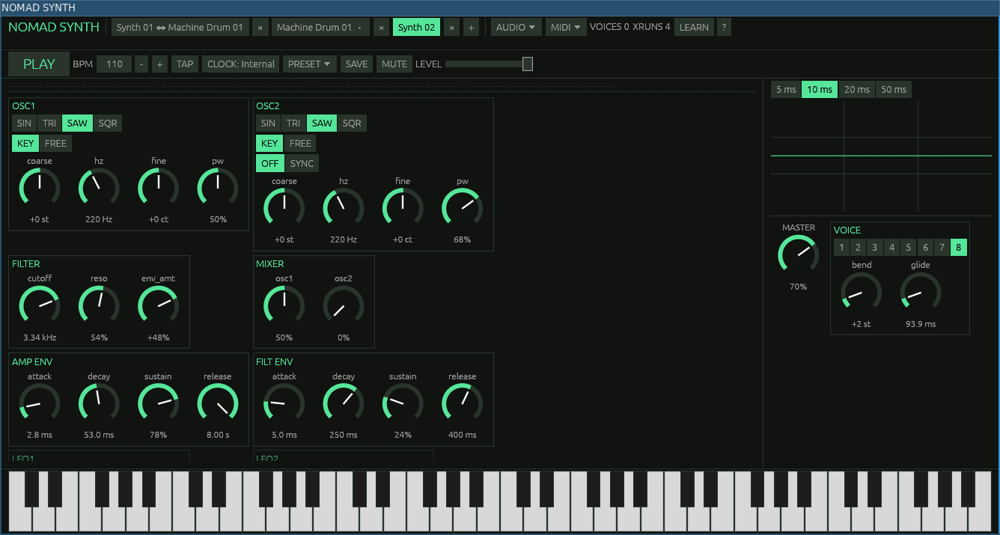

# NOMAD Synth

[](https://github.com/nobelaar/nomad-synth/actions/workflows/rust.yml)
[](https://github.com/nobelaar/nomad-synth/releases)
[](LICENSE)

**Sintetizador polifónico de inspiración analógica, con secuenciador de acordes y caja de ritmos, pensado para tocarse como un instrumento.**

Perillas en vez de menús, un secuenciador de pasos como el de los sintes de hardware, varias
instancias sonando a la vez con relojes compartidos, y un motor de audio en tiempo real escrito en
Rust que no asigna memoria en el hilo de audio. Es un solo programa: lo bajás y lo abrís.



## Características

**Sintetizador**
- 8 voces, 2 osciladores por voz (seno, triángulo, sierra y cuadrada con PWM), sin alias gracias a PolyBLEP, con hard sync y modo de frecuencia libre.
- Filtro escalera de 4 polos con resonancia que autooscila.
- 2 envolventes ADSR (amplitud y filtro) y 2 LFOs (con sample & hold).
- Matriz de modulación de 8 slots (LFOs, rueda, velocidad y envolvente hacia afinación, filtro, amplitud y PWM).
- Glide (portamento) en todas las voces y legato en modo mono.

**Secuenciador**
- 16 pasos con acordes de hasta 6 notas por paso.
- Grabación por pasos (cada tecla escribe y avanza; varias teclas juntas graban un acorde) y en vivo, cuantizada al paso más cercano.
- División de 1/16 a un compás por paso, largo de 1 a 16 pasos, gate y swing.

**Machine Drum**
- Seis instrumentos sintetizados: bombo, caja, clap, tom y hi-hats cerrado y abierto. No usa samples.
- 16 pasos con acentos, swing, y afinación, caída y nivel por instrumento.

**Sesión**
- Pestañas: tantos Synths y Machine Drums como quieras, todos sonando y mezclados.
- Relojes: cada instrumento marca su tempo o sigue el de otro, que le pasa el BPM, la posición y el PLAY.
- Presets de fábrica y propios, con el sonido y el patrón.
- MIDI: notas, velocidad, pitch bend, rueda, pedal de sustain y **MIDI learn** para asignar cualquier perilla a un CC.
- Modo ayuda: pasás el mouse por un control y te explica qué hace.
- Osciloscopio, teclado en pantalla y cambio de dispositivo de audio o puerto MIDI sin cortar el sonido.

## Descargar

**Linux (x86_64):** bajá el AppImage de la [última versión](https://github.com/nobelaar/nomad-synth/releases/latest), dale permiso de ejecución y abrilo:

```bash
chmod +x NOMAD-*-x86_64.AppImage
./NOMAD-*-x86_64.AppImage
```

Si tu sistema no tiene FUSE, agregá `--appimage-extract-and-run`. En la misma página hay un
`.tar.gz` con el binario suelto y un `SHA256SUMS` para verificar las descargas
(`sha256sum -c SHA256SUMS`).

**Requisitos:** glibc 2.35 o más nuevo (Ubuntu 22.04, Debian 12, Fedora 36 o posteriores), audio
por ALSA o PipeWire, y gráficos con OpenGL o Vulkan.

**Windows y macOS:** todavía no hay instaladores. El código compila y pasa el CI en las dos
plataformas, pero falta probar el audio y el MIDI con hardware real. Si podés ayudar a probarlo,
[abrí un issue](https://github.com/nobelaar/nomad-synth/issues).

## Primeros pasos

1. Abrí NOMAD. Arranca con un **Synth** y una **Machine Drum**, cada uno en su pestaña.
2. Tocá el teclado en pantalla, o conectá un teclado MIDI y elegilo en el menú `MIDI`.
3. En la barra de arriba, `PRESET` carga un sonido. Probá **Pad de acordes** en el Synth y **4x4** en la batería.
4. `PLAY` arranca el instrumento de la pestaña elegida. Para que el Synth y la batería vayan juntos, en el Synth elegí `CLOCK: Machine Drum 01`.
5. Para grabar acordes: `REC` con el reloj parado, mantené apretadas las teclas del acorde y soltalas; el cursor pasa al paso siguiente. Con `DIV 1 bar` y `LEN 4` tenés una progresión de cuatro compases en loop.

## Controles

| Gesto | Efecto |
|---|---|
| Arrastrar una perilla hacia arriba o abajo | Cambia el valor (200 px es el recorrido completo) |
| `Shift` + arrastrar, o la rueda del mouse | Ajuste fino / por pasos |
| Doble clic en una perilla | Vuelve al valor por defecto |
| Clic derecho en un control | **Valor por defecto**, **MIDI learn** y **Quitar MIDI** |
| `LEARN` | Arma MIDI learn sobre el último control que tocaste; después mové una perilla del controlador |
| `?` o `F1` | Modo ayuda: pasá el mouse por un control para ver qué hace (`Esc` para salir) |
| Clic en un paso | Lo prende o lo apaga |
| `Shift` + clic en un paso | Lo acentúa |
| Rueda sobre un paso del Synth | Transpone el paso entero (con `Shift`, una octava) |
| `REC` / `REST` | Graba notas en la secuencia / deja un paso en silencio al grabar por pasos |
| `DIV` / `LEN` / `GATE` | Duración de cada paso / cantidad de pasos / duración de las notas |
| Nombre de un instrumento de la batería | Lo dispara para escucharlo |
| `BPM`, `-`, `+`, `TAP` | Tempo: arrastrando, de a uno, o marcándolo a mano |
| `CLOCK` | Reloj propio o el de otro instrumento |
| `MUTE` / `LEVEL` / `MASTER` | Silencio y nivel de cada instrumento / volumen general |
| `+` y `×` en las pestañas | Agregar o cerrar instrumentos |

## MIDI

- Notas con velocidad, pitch bend (rango con la perilla `bend`), rueda de modulación (fuente `MW` de la matriz), pedal de sustain (CC64) y CC120/CC123 para apagar todo.
- El teclado y el MIDI tocan el Synth de la pestaña elegida. Los CC asignados con MIDI learn también actúan sobre ese Synth.
- Las asignaciones se guardan por puerto y canal. Si cambiás de puerto, vale la asignación del mismo canal y CC.

## Configuración

NOMAD guarda sus archivos en `~/.config/nomad-synth/` (o en `$XDG_CONFIG_HOME/nomad-synth/`):

- `midi-map.json`: las asignaciones de MIDI learn.
- `presets/synth/` y `presets/drums/`: tus presets, en JSON.

## Línea de comandos

```
nomad                 abre la ventana
nomad gui [--mcp [PUERTO]]  abre la ventana; con --mcp, también el servidor MCP (por defecto 7777)
nomad --mcp [PUERTO]  igual que la línea anterior
nomad --version       muestra la versión
nomad devices         lista las salidas de audio
nomad demo            toca una escena de demo sin ventana (--device N, --seconds S, --midi)
nomad midi            muestra lo que llega por MIDI (--port TEXTO, --seconds 20)
nomad bench           mide el costo del motor sin dispositivo (--voices 8, --synths 2, --block 512)
nomad soak            prueba larga con audio real y cuenta xruns (--minutes 10)
```

## Servidor MCP

`nomad --mcp` (o `nomad gui --mcp 9000`) levanta un servidor MCP local en `http://127.0.0.1:PUERTO/mcp` (HTTP, solo loopback; el puerto 0 no se acepta) para que un agente de IA toque el sintetizador en vivo. Registralo, por ejemplo:

```
claude mcp add --transport http nomad http://127.0.0.1:7777/mcp
```

Seguridad:

- Solo escucha en localhost (127.0.0.1).
- Revisa los encabezados Host y Origin: cualquier otro valor recibe 403.
- Está apagado por defecto: solo se abre con `--mcp`.
- `note_on` suelta la nota solo, como máximo a los 10 s (`duration_ms` hasta 10000).
- `panic` silencia todo y también detiene los relojes de todos los instrumentos.
- Acepta pedidos de cualquier página servida desde localhost o 127.0.0.1 (cualquier puerto): activá `--mcp` solo mientras confíes en los programas y páginas que corren en tu máquina.

Herramientas:

- Lectura: `get_state`, `get_instrument`, `list_params`, `list_presets`
- Instrumentos, sonido y transporte: `add_instrument`, `close_instrument`, `select_instrument`, `set_target`, `set_source`, `set_param`, `set_master`, `set_level`, `set_mute`, `set_bpm`, `play`, `stop`
- Notas, secuenciador y baterías: `note_on`, `panic`, `drum_trigger`, `seq_set_step`, `seq_set`, `seq_enable`, `seq_clear`, `drum_set_step`, `drum_clear`
- Presets y pestañas: `load_preset`, `save_preset`, `open_spiral`, `close_spiral`

## Compilar desde el código

Necesitás [Rust](https://rustup.rs) estable y las cabeceras de ALSA (`libasound2-dev` en
Debian/Ubuntu, `alsa-lib` en Arch, `alsa-lib-devel` en Fedora).

```bash
git clone https://github.com/nobelaar/nomad-synth.git
cd nomad-synth/rust
cargo build --release -p nomad-app
./target/release/nomad
```

El AppImage y el tarball se arman con `packaging/linux/build.sh` y quedan en `rust/target/dist/`.

## Arquitectura

El código de Rust vive en `rust/`, en tres crates:

| Crate | Qué hace |
|---|---|
| `nomad-core` | El motor: osciladores, filtro, envolventes, LFOs, matriz, voces, secuenciador, relojes, batería y mezclador. Sin dependencias de audio ni de interfaz. |
| `nomad-runtime` | Tiempo real: el hilo de audio es dueño del motor y recibe comandos por colas sin bloqueo. Incluye la salida con `cpal`, la entrada MIDI con `midir`, MIDI learn y la telemetría. |
| `nomad-app` | La interfaz con `egui`, el modelo de la app, los presets y la línea de comandos. |

Decisiones de diseño:

- **El hilo de audio no asigna, no libera y no se bloquea.** Lo verifican tests con un asignador que cuenta asignaciones. Lo que hay que crear o destruir (instrumentos, sonidos de batería) se arma y se libera fuera de ese hilo.
- **La interfaz nunca toca el motor directamente.** Lee espejos atómicos que el hilo de audio publica y escribe solo por comandos.
- **El motor está verificado contra audio de referencia** (`rust/reference/`), muestra a muestra con una tolerancia de 1e-9.

## Rendimiento

Medido con `nomad bench` en un Intel Core i5-4300M (2014), con bloques de 512 muestras a 48 kHz:

| Escena | Promedio | Peor bloque |
|---|---|---|
| 1 Synth de 8 voces + batería | 1,5 % | 5,1 % |
| 2 Synths de 8 voces + batería | 3,1 % | 6,8 % |

El porcentaje es la parte del tiempo de cada bloque que usa el motor. Corré `nomad bench` en tu máquina para ver el tuyo.

## Hoja de ruta

- Instaladores para Windows y macOS, una vez probados con hardware real.
- SLIDE por paso en el secuenciador, estilo 303.
- Sincronía con reloj MIDI externo.

## Contribuir

Los issues y pull requests son bienvenidos. Antes de mandar un cambio, corré lo mismo que corre el CI:

```bash
cd rust
cargo fmt --all -- --check
cargo clippy --workspace --all-targets -- -D warnings
cargo test --workspace
```

Si el cambio toca audio, agregá un test. Si toca el hilo de audio, que siga pasando `no_alloc`.

## Licencia

NOMAD es software libre bajo la licencia [GPL-3.0-or-later](LICENSE). Las licencias de los
componentes de terceros (incluidas las fuentes de `egui` y las tablas del zigurat de numpy) están en
[`THIRD_PARTY_NOTICES.md`](THIRD_PARTY_NOTICES.md).
